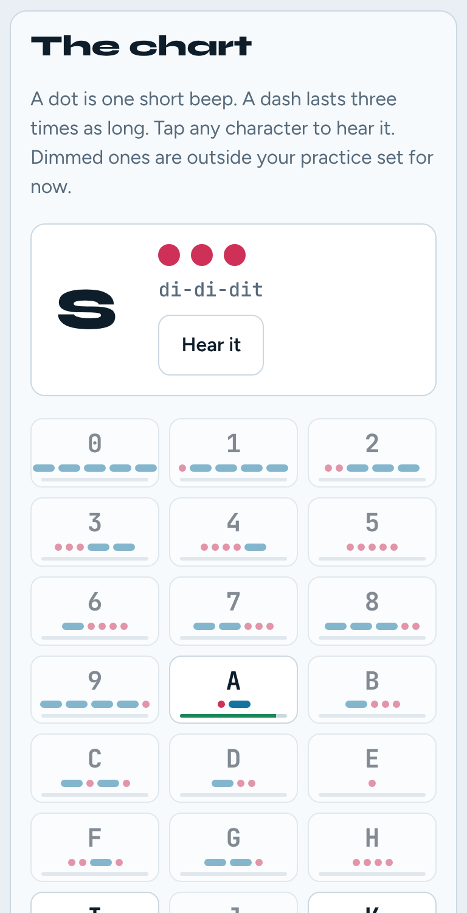
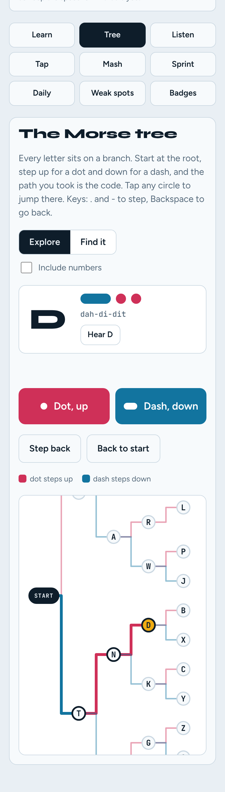
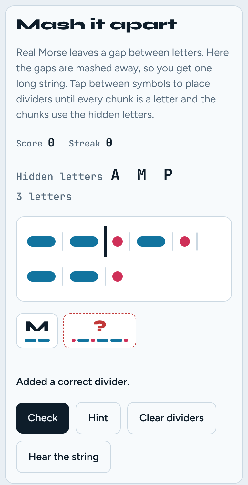
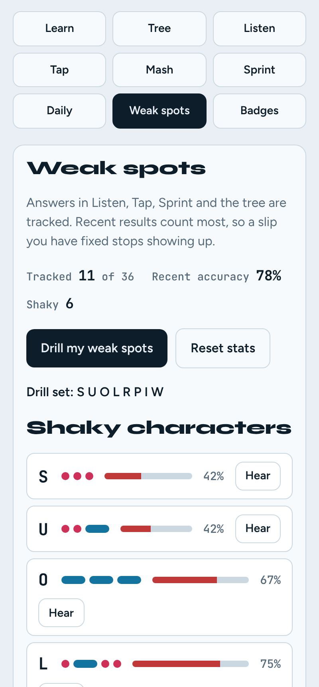
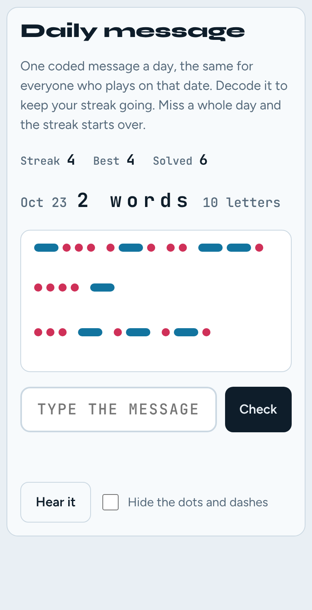
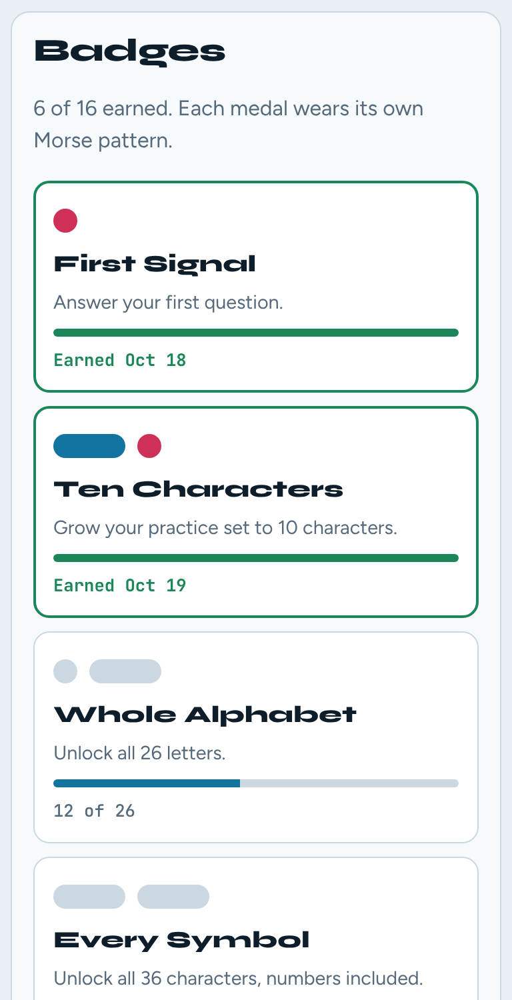

# Morse Mash

A browser game that helps people **learn, use and understand Morse code**. Hear it, tap it, see it as a tree, split it apart, and play it by sound, light or vibration.

No build step, no dependencies, no accounts and no tracking. Everything runs in the page and your progress stays in your browser.

<p>
  
  
  
</p>
<p>
  
  
  
</p>

## Play it

Open `index.html` in a browser. That is all.

If you would rather serve it (some browsers are stricter about files opened from disk):

```bash
npm start          # python3 -m http.server 8080, then open http://localhost:8080
```

Use it online, see [GitHub Pages](https://7h3v01d.github.io/morse_mash/).

## What's in the game

Dots are always pink and dashes always blue, so the colour teaches the shape of each character.

| Tab | What you do |
| --- | --- |
| **Learn** | Tap any of the 36 characters to hear it and see its dots and dashes. A playground sends any text you type. |
| **Tree** | A branching diagram. Start at the root, step up for a dot and down for a dash, and the path you take is the code. **Find it** hides the labels and asks you to walk to a letter from memory. |
| **Listen** | An ear trainer. Hear a character, pick it from four choices. Score 90% over ten answers and the next character unlocks. |
| **Tap** | Send the character shown on an on-screen key or with the Space bar. A short press is a dot, a long press is a dash. |
| **Mash** | You get a word's dots and dashes with the letter gaps removed. Place dividers to split it back into letters. Afterwards you see how many different ways the same string could be split. |
| **Sprint** | A 60 second decode round. Words flash up as dots and dashes and you type them. |
| **Daily** | One coded message a day, the same for everyone on that date, with a streak counter. |
| **Weak spots** | Shows your shaky characters, the pairs you mix up, and a heat map of all 36. One button drills them in Listen. |
| **Badges** | 15 badges with progress bars. Each medal wears its own Morse pattern. |

### Settings

- **Practice set** (2 to 36): how many characters are in play, added in the Koch order `K M R S U A P T L O W I N J E F Y V G Q Z H B C D X 0-9`.
- **Speed** (5 to 25 WPM): uses the standard PARIS timing, where one unit is `1200 / WPM` milliseconds.
- **Signals**: **Sound**, **Light** (a flashing bar that stays at the top of the page) and **Buzz** (phone vibration). Any mix works, and at least one stays on, so every mode can be played with the sound off.

### Keyboard

| Where | Keys |
| --- | --- |
| Tap | Hold **Space** to send |
| Listen | Press the character to answer, **Space** or **Enter** to replay or go on |
| Tree | **.** or **Up** for a dot, **-** or **Down** for a dash, **Backspace** or **Left** to step back, **Esc** to restart |

## How it works

- **Timing.** A dot is 1 unit, a dash is 3, the gap inside a letter is 1, between letters 3 and between words 7. Tap input counts any press under 2 units as a dot.
- **Koch order.** Characters are introduced a few at a time, starting with sounds that are easy to tell apart, instead of A to Z.
- **Weak spots.** Each character keeps its last 12 results, so a slip you have fixed fades out. A character is *shaky* when it has at least 3 results and its recent accuracy (nudged toward 50% so one lucky answer does not look like mastery) is under 80%. Wrong answers are also logged as pairs, and Listen picks its wrong choices from your own mix-ups.
- **Mash.** Words are picked so that no other split of the string uses the same set of letters, which keeps the puzzle fair. The letters are listed as a clue, in alphabetical order so they do not give the order away.
- **Daily message.** The phrase depends only on the local date, `dayNumber * 7919 mod 50`, so there is no server. The streak grows on consecutive days and lapses after a missed day.
- **Storage.** Progress is saved in `localStorage` under the key `morsemash.v1`. *Weak spots > Reset stats* clears character history and mix-ups. To clear everything, including badges and streaks, clear the site's data in your browser.

## Project layout

```
index.html            page markup
css/style.css         styles, light and dark themes, font-face rules
js/morse-core.js      pure logic: Morse table, timing, tree, weak spots, mash, daily, badges
js/app.js             UI, audio, vibration, storage and the game modes
fonts/                bundled fonts (SIL Open Font License) and their licences
test/core.test.js     unit tests for the core logic (node:test, no dependencies)
docs/screenshots/     images used in this README
.github/workflows/    CI tests and GitHub Pages deployment
```

`morse-core.js` has no DOM or storage access. It loads in the browser as `window.MorseCore` and in Node with `require`, which is why it can be tested on its own.

## Tests

Needs Node 18 or newer and nothing else.

```bash
npm test
```

## Deploy to GitHub Pages

1. Push this repo to GitHub with `main` as the default branch.
2. In the repo, go to **Settings > Pages** and set **Source** to **GitHub Actions**.
3. Push to `main`. The *Deploy to GitHub Pages* workflow runs the tests and publishes the site. The address appears in the workflow run and under Settings > Pages.

Prefer no workflow? Set **Source** to **Deploy from a branch**, choose `main` and `/ (root)`, and delete `.github/workflows/pages.yml`.

## Accessibility and safety

- Every mode works without sound, using the flashing bar or phone vibration.
- Controls are real buttons and inputs, keyboard operable, with visible focus and labels. Animation respects `prefers-reduced-motion`.
- Fast flashing can bother people who are sensitive to it. The Light option includes a note, and a lower speed slows the flashing.
- **Buzz** needs the Vibration API, which is mostly available in Chrome on Android. It is not available on iPhone or most desktops, and the option is disabled where it is unsupported.

## Browser support

Current versions of Chrome, Edge, Safari and Firefox. The page uses `color-mix()`, CSS custom properties and the Web Audio API.

## Ideas for what's next

- Send a friend a coded message with a challenge link
- Farnsworth timing (fast characters, longer gaps)
- A printable cheat sheet
- Prosigns such as AR and SK, and practice noise
- Share your daily result

Pull requests are welcome. Run `npm test` before opening one.

## Credits

Fonts are bundled from [Fontsource](https://fontsource.org): [Syne](https://gitlab.com/bonjour-monde/fonderie/syne-typeface), [Figtree](https://github.com/erikdkennedy/figtree) and [JetBrains Mono](https://github.com/JetBrains/JetBrainsMono), all under the SIL Open Font License 1.1 (see `fonts/licenses/`).

## License

[MIT](LICENSE). Edit the copyright line to your own name before publishing.
