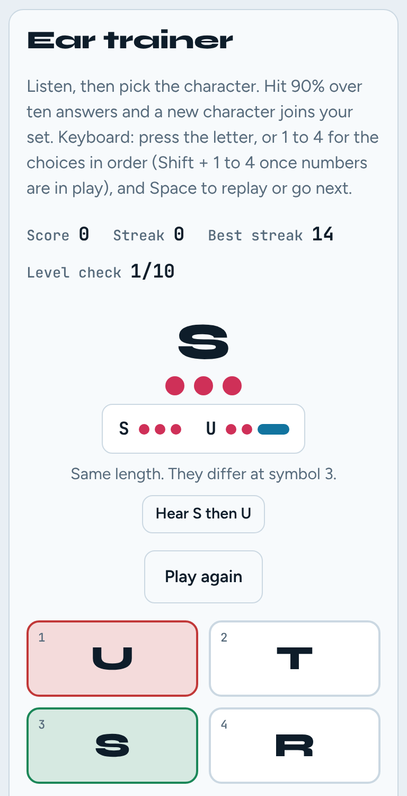
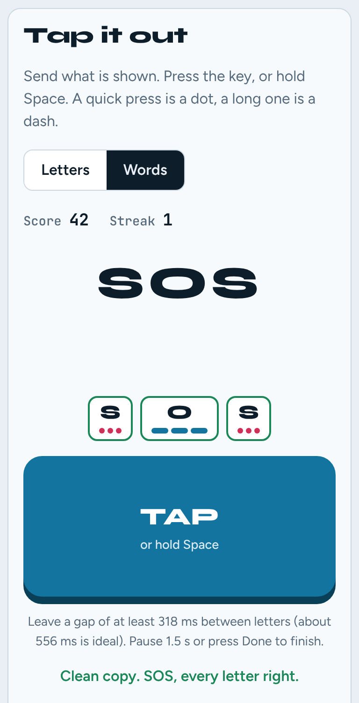
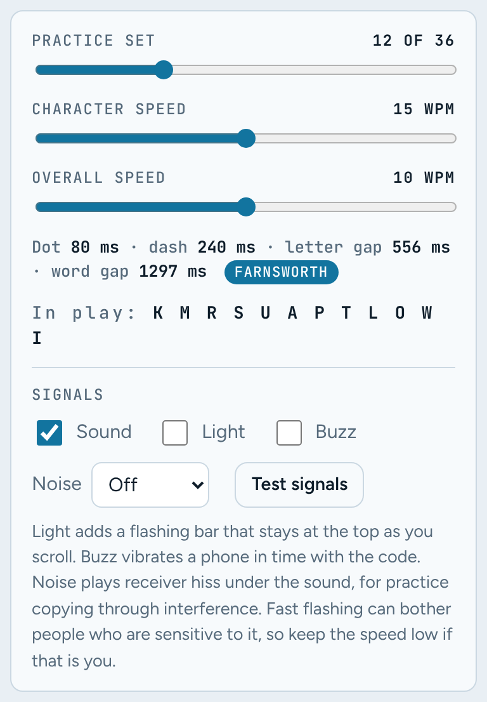

# Morse Mash

**Learn Morse code by ear, by hand and by eye, in your browser.**

Morse Mash is a free game for learning Morse code. You hear it, send it, walk the Morse tree, split run-together code back into letters, and decode a new message every day. It follows the methods experienced operators recommend: Koch order, Farnsworth spacing and practice that targets your weak spots.

There's no sign-up, no tracking and nothing to install. Everything runs in the page, and your progress stays in your own browser.

[](https://github.com/7h3v01d/morse-mash/actions/workflows/ci.yml)
[](LICENSE)


### [▶ Play Morse Mash](https://7h3v01d.github.io/morse-mash/)

<p>
  
  
  
  
</p>
<p>
  
  
  
  
</p>

## Why Morse Mash

- **Learn the sound, not the chart.** New characters arrive one at a time in [Koch order](#how-it-teaches). With Farnsworth spacing each character plays at full speed, so you hear its rhythm as a whole instead of counting dots.
- **Practice what you get wrong.** Every answer is tracked. The game finds your shaky characters and the pairs you mix up, then drills them. Wrong choices in the ear trainer come from your own past mix-ups.
- **Receive and send.** Copy by ear in Listen and Sprint, then send single characters or whole words on an on-screen key or the Space bar, scored letter by letter.
- **Play it your way.** Every mode works by sound, by a flashing light or by phone vibration, in any mix, so you can practise with the sound off.
- **See why spacing matters.** Mash removes the gaps between letters and asks you to put them back. Then it shows how many other ways the same dots and dashes could be read.

## Game modes

Dots are always pink and dashes always blue, so the colour teaches the shape of each character.

| Tab | What you do |
| --- | --- |
| **Learn** | Tap any of the 36 characters to hear it and see its dots and dashes. Eight prosigns (AR, AS, BT, CT, HH, KN, SK, SOS) sit below the chart. A playground sends anything you type, with prosigns in angle brackets like `CQ <KN>`. You can print a one-page cheat sheet in colour or black and white. |
| **Tree** | The Morse tree. Step up for a dot and down for a dash, and the path you take is the code. **Find it** hides the labels and asks you to walk to a letter from memory. |
| **Listen** | The ear trainer. Hear a character and pick it from four choices. Score 90% over ten answers and the next character unlocks. A wrong answer shows both codes side by side with a note on how they differ and replays the right one. Once you have all 26 letters you can add prosigns. |
| **Tap** | Send with an on-screen key or the Space bar: a short press is a dot, a long one is a dash. **Letters** sends one character at a time. **Words** sends a whole word and marks each letter right or wrong, telling you if letters ran together. |
| **Mash** | A word's code with the letter gaps removed. Place dividers to split it back into letters. |
| **Sprint** | 60 seconds to decode as many words as you can, by sight or by signal alone. |
| **Daily** | One coded message a day, the same for everyone on that date. Keep your streak going and share your result. |
| **Weak spots** | Your shaky characters, your most common mix-ups and a heat map of everything you've practised, with one button to drill them. You can also back up your progress or restore it here. |
| **Badges** | 16 badges with progress bars. Each medal wears its own Morse pattern. |

## Settings



- **Practice set**: how many characters are in play (2 to 36), added in Koch order: `K M R S U A P T L O W I N J E F Y V G Q Z H B C D X 0-9`.
- **Character speed** (5 to 25 WPM): how fast each character is sent.
- **Overall speed**: set it below the character speed to switch on Farnsworth spacing. Characters stay fast and only the gaps stretch. A live readout shows each dot, dash and gap in milliseconds.
- **Signals**: **Sound**, **Light** (a flashing bar that stays in view as you scroll) and **Buzz** (phone vibration), in any mix. **Noise** adds receiver hiss at three levels for practice copying through interference.

<br clear="right">

### Keyboard

| Where | Keys |
| --- | --- |
| Listen | Type the character, or press **1** to **4** to pick a choice by position. Once digits are in play, use **Shift + 1** to **4**, since **1** then means the character 1. **Space** or **Enter** replays or moves on. |
| Tap | Hold **Space** to send. In Words mode, **Enter** finishes the word. |
| Tree | **.** or **Up** for a dot, **-** or **Down** for a dash, **Backspace** or **Left** to step back, **Esc** to go back to the start. |

## How it teaches

- **Koch order.** You start with a handful of characters that sound very different and add one at a time once you're accurate, rather than learning A to Z.
- **Farnsworth spacing.** With character speed `c` and overall speed `s`, the spacing in one PARIS word is `(60c − 37.2s) / (s · c)` seconds (the ARRL formula). That spacing is split across the gaps between letters and words. The tests check that `PARIS ` then takes exactly `60 / s` seconds.
- **Standard timing.** A dot is 1 unit, a dash 3, the gap inside a letter 1, between letters 3 and between words 7, with one unit = `1200 / WPM` ms. Prosigns are sent as one run with no letter gap.
- **Weak spots.** Each character keeps its last 12 results, so a slip you've since fixed fades away. A character counts as shaky when it has at least 3 results and its recent accuracy is under 80%. That accuracy is nudged toward 50%, so one lucky answer doesn't look like mastery.
- **Sending words.** A pause between presses longer than halfway between an in-letter gap and a letter gap starts a new letter. With Farnsworth spacing that threshold stretches too, and the Tap tab tells you the exact gap to aim for.
- **Fair puzzles.** Mash only uses words where no other arrangement of the same letters fits the same string.

## Run it yourself

It's plain HTML, CSS and JavaScript with no build step. Clone the repo and open `index.html`, or serve the folder:

```bash
git clone https://github.com/7h3v01d/morse-mash.git
cd morse-mash
npm start        # python3 -m http.server 8080, then open http://localhost:8080
```

### Host your own copy on GitHub Pages

1. Fork the repo.
2. Go to **Settings > Pages** and set **Source** to **GitHub Actions**.
3. Push to `main`. The *Deploy to GitHub Pages* workflow runs the tests and publishes the site.

## Your data

- Progress is saved only in your browser's `localStorage`. Nothing is sent anywhere, and there are no analytics, cookies or accounts.
- **Weak spots > Download a backup** saves your progress as a JSON file. **Restore from file** loads it on another device or browser. Restored files are checked and anything malformed is dropped.
- **Reset stats** clears character history and mix-ups. To clear everything, including badges and streaks, clear the site's data in your browser.

## Accessibility

- Every mode can be played without sound, using the flashing light or vibration.
- Controls are real buttons and inputs, keyboard operable, with visible focus and labels. Animation respects `prefers-reduced-motion`.
- Fast flashing can bother people who are sensitive to it. Lowering the speed slows the flashing.
- Light and dark themes follow your system setting.
- **Buzz** needs the Vibration API, which is mostly limited to Chrome on Android. It isn't available on iPhone or most desktops, and the option is turned off where it's unsupported.

Works in current versions of Chrome, Edge, Safari and Firefox.

## Contributing

Bug reports, ideas and pull requests are welcome. Please [open an issue](https://github.com/7h3v01d/morse-mash/issues) first for anything large.

```bash
npm test         # Node 18 or newer, no install needed
```

### Project layout

```
index.html            page markup
css/style.css         styles, light and dark themes, print layout
js/morse-core.js      pure logic: Morse table, prosigns, timing, tap segmentation,
                      tree, weak spots, mash, daily message, badges, saved state
js/app/shared.js      state, storage, audio, vibration, helpers and the mode registry
js/app/settings.js    the settings bar and signals
js/app/<mode>.js      one file per tab: learn, tree, listen, tap, mash, sprint, daily, weak, badges
js/app/main.js        start-up, tabs and keyboard routing (loads last)
test/core.test.js     unit tests for the core (node:test)
fonts/                bundled fonts and their licences
docs/screenshots/     images for this README
.github/workflows/    CI tests and GitHub Pages deployment
```

### Guidelines

- **Keep `morse-core.js` pure.** No DOM, storage or timers. It loads in the browser as `window.MorseCore` and in Node with `require`, which is what makes it testable. New logic belongs there, with tests.
- **Adding a mode** takes one file in `js/app/` that calls `MM.register(name, { show, leave, onKey, onKeyUp, onPool })` (every hook is optional), one `<script>` tag, one tab button and one panel. Views that depend on saved state register with `MM.onRefresh`.
- **No dependencies and no build step.** The page should keep working when opened straight from disk.
- **Saved state** always goes through `restoreState`, so old saves and imported files stay safe. If you add a field, give it a default in `freshState` and a check in `restoreState`.

### Ideas

- Send a friend a coded message with a challenge link
- Prosigns in Tap's sending practice
- Timed or scored rounds for the tree's Find it mode
- A timing chart after sending a word, showing which gaps were too short

## Credits

Fonts are bundled from [Fontsource](https://fontsource.org): [Syne](https://gitlab.com/bonjour-monde/fonderie/syne-typeface), [Figtree](https://github.com/erikdkennedy/figtree) and [JetBrains Mono](https://github.com/JetBrains/JetBrainsMono), all under the SIL Open Font License 1.1 (see `fonts/licenses/`).

## License

Copyright 2026 Leon Priest. Licensed under the [Apache License, Version 2.0](LICENSE). See [NOTICE](NOTICE) for attributions.

The bundled fonts keep their own licence, the SIL Open Font License 1.1.
